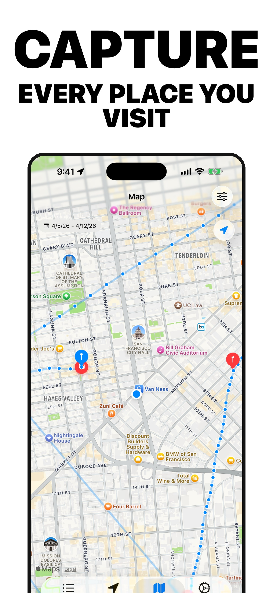
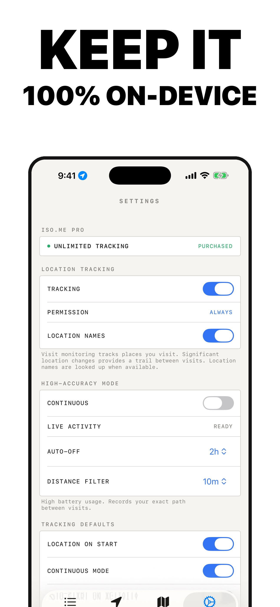
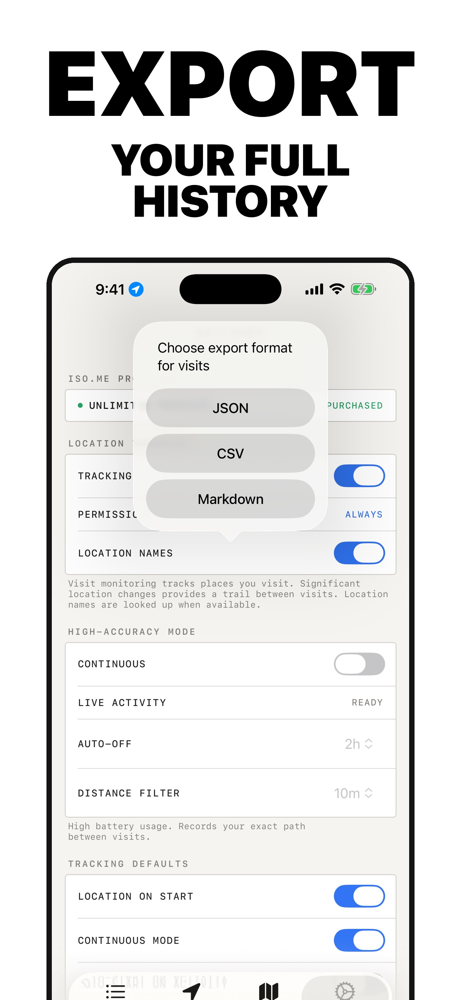

# Whereday

The unpublished candidate removes custom in-app analytics, installation-linked event uploads, and advertising attribution. Upgrades erase retired local analytics state. Essential purchase, scheduling, provider and user-requested services remain; myself.md purchase claims stay disabled. Earlier released versions and retained server data require a separate approved retirement. Website measurement is a separate surface and is not removed by this app change.

> **Open source location journaling for iPhone and Apple Watch, with your working history stored on your device.**

[](LICENSE)
[](#tech-stack)
[](#tech-stack)

Whereday is a location tracking app for iOS and watchOS. It automatically records the places you visit throughout the day, tracks routes with continuous GPS logging, and **stores your working location journal on-device**. No Whereday account or server-side location archive. Apple geocoding and Maps services, first-party onboarding telemetry in earlier releases (disabled in the intended 1.8 release), and optional exports/webhooks have specific network behavior explained in the [privacy policy](https://whereday.com/privacy).

**[🌐 whereday.com](https://whereday.com)** · **[📲 Download on the App Store](https://apps.apple.com/app/id6761960794)** · **[🛠 Contribute](CONTRIBUTING.md)** · **[💬 Discussions](https://github.com/CodyBontecou/whereday/discussions)** · **[👥 Discord](https://discord.gg/jNRWSSSz4N)** · **[⭐ Star this repo](https://github.com/CodyBontecou/whereday)**

## User guides and checked examples

For the public app, start with the [product documentation](https://whereday.com/docs/) or choose a task below. The guides identify what was checked and where a workflow still needs verification.

| Your task | Guide and available evidence |
|---|---|
| Find an earlier day | [Find iPhone location history](https://whereday.com/blog/view-location-history-iphone/): Apple/Google paths, date selection, and preserving existing records. |
| Start a local journal | [Private location journal setup](https://whereday.com/blog/private-location-journal-iphone/): controls and a checked empty-path example that distinguishes a timer from saved GPS points. |
| Use a route file | [Record and export GPX](https://whereday.com/blog/record-iphone-route-gpx/): synthetic points exported through the released app’s UI and Files, then checked in gpx.studio. |
| Keep supported records | [Backup checklist](https://whereday.com/blog/back-up-iphone-location-history/): separate visit/point files, supported formats, and destination checks. |
| Reuse a place name | [Saved locations and CSV](https://whereday.com/docs/places/): released editor controls and a sample checked through native parsing, storage, and duplicate handling. |
| Read visits as notes | [Markdown journal in Obsidian](https://whereday.com/blog/iphone-location-journal-obsidian/): an actual export checked in a desktop vault. |
| Send points to a receiver | [Dawarich Overland setup](https://whereday.com/integrations/dawarich/): native delivery of three synthetic points, checked after a receiver/database restart. |
| Review travel dates | [Country Days guide](https://whereday.com/blog/track-days-in-country-iphone/): local dates, manual stays, travel days, and gaps. |

See [all integration workflows](https://whereday.com/integrations/) and the [released Siri and Shortcuts action reference](https://whereday.com/docs/siri-shortcuts/). Synthetic examples are invented data; they do not establish physical recording, complete device restoration, or unattended background delivery.

## Screenshots

| Capture every visit | Keep it on-device | Export your history |
|---|---|---|
|  |  |  |

## Features

### Visit Detection
Automatic background detection of places you arrive at and depart from, powered by `CLLocationManager` visit monitoring. Each visit is reverse-geocoded to show a human-readable address and location name.

### Continuous Tracking
High-accuracy GPS tracking that records your exact path. Configurable distance filter (5m-200m) and auto-off timer (30 min to never). Tracked points include altitude, speed, and accuracy metadata.

### Dark Mode
Follow the device appearance or choose Light or Dark in **Settings → Appearance → Theme**. The shared palette adapts across the map, timeline, settings, export, and onboarding screens.

### Manual Visits
Manual visits can be logged from the map, including past visits at a selected location. Confirm or correct detected places and edit arrival/departure times from Visit Details. Development source additionally supports **Check Out** on an open manual visit and an overlap warning with **Save Anyway**. These newer controls are not part of the verified public 1.7.16 release. See the [development automation QA](docs/testing/manual-visit-shortcuts.md) for that source workflow. Apple Maps place searches may send your query and search area to Apple. Development source also enforces the **Location Names** opt-out for nearby suggestions, typed place search, and pin address lookup; you can still choose coordinates and enter a name yourself. Its map markers use both symbols and colors for unconfirmed, confirmed, corrected, and manual visits.


### Country Days
The free **Timeline → Country Days** screen counts unique local dates present in each country from recorded visits and route points. Filter by this year, the last 365 days, or all time; open a country to review individual dates. Travel days can count in both countries. Add, edit, or delete manual stays to cover missing records; overlapping dates are deduplicated.

New recordings identify countries using the existing network-geocoding preference. **Analyze saved locations** resolves earlier history in resumable batches and respects network opt-out. Dates use the resolved location's time zone. Unknown locations, outliers, and gaps are not assigned invented days; open visits and unverified departure times contribute only the arrival day. Existing history with unverified departures may need manual stays for multi-day totals. Country-day CSV export uses the existing lifetime export purchase and includes the country code, local date, and recorded/manual source.

### Live Activities
Real-time tracking status on the lock screen and Dynamic Island. Shows current location, distance traveled, points recorded, and remaining auto-off time.

### Export & Import
Export visits and location points in eight formats, including JSON, CSV, Markdown, and GPX. Choose a date range, time-of-day window, and per-format field toggles, and either condense everything into a single file or split the export into **one file per day** for easier downstream slicing. Customize filenames and dated subfolders with tokens (for example, Markdown can use `{year}/{year}-{month}/Daily Track - {date}.md`). Optionally set a default export folder for one-tap saves and schedule an automatic export — once per day, or **repeated every 1–23 hours** from a start time. Automatic exports always keep one consistent dated file per local day; interval runs can either fully rewrite that day's file or append only new records. Scheduled exports use a routing-only APNs worker to wake the app near each occurrence; your location records, files, folder paths, and filename templates stay on-device. Import previously exported data back into the app. Export is the one paid feature — see [Pricing](#pricing).

#### Google Timeline import in development source

The verified public **1.7.16 (46)** release predates this importer. The following describes repository source; use the [public export/import reference](https://whereday.com/docs/export-import/) for that released build.

Google Timeline imports use **Settings > Data Import > Import File**. Select one JSON file, review its format, date range, new records, and duplicates, then choose visits and/or points and confirm. Canceling the preview writes nothing. Imports run locally without a Google login, upload, or place lookup.

Supported Google exports are classic Location History (`locations` with E7 coordinates and millisecond/ISO timestamps), legacy Semantic Timeline (`timelineObjects` with place visits and timed activity paths), and device Timeline (`semanticSegments` or an iOS root array, including `geo:`/degree coordinates and timed paths). On iPhone, [export Timeline data from Google Maps](https://support.google.com/maps/answer/6258979?co=GENIE.Platform%3DiOS&hl=en) and save the JSON to Files. Unzip Takeout archives first and select individual JSON files. Folders and ZIP archives are outside this MVP.

Duplicate detection always skips matches within the file and against stored records. Points match at the same rounded second within 10 meters; visits match within 60 seconds of arrival, 5 minutes of departure, and 100 meters (open visits only match other open visits). Confirmation checks again before saving, preserving existing names, notes, and confirmations. These thresholds are approximate, so review the counts. Raw location history imports points only; this version does not infer visits or invent timestamps for untimed waypoints. Invalid records and unsupported entries are counted in the preview. Each file is limited to 50 MiB and 250,000 visits plus points; larger exports must be split. Existing Whereday JSON, CSV, and Markdown imports use the same preview, and combined JSON backups preserve both visits and points.


#### Markdown handoff to Obsidian

For a checked desktop file workflow, use the [Markdown handoff guide](https://whereday.com/blog/iphone-location-journal-obsidian/). Its optional [Whereday Maps example](https://whereday.com/blog/iphone-location-journal-obsidian/#map-plugin) checks plugin 0.7.15 with two invented native-export visits in Obsidian 1.14.5, including marker popups, tile-provider limits, and Markdown timezone behavior. Mobile transfer and scheduled vault delivery remain unverified.

### Watch App
The companion watchOS app records GPS points without the iPhone nearby and queues them for later transfer through WatchConnectivity. Check the phone copy after reconnecting; follow the [Watch recording and sync reference](https://whereday.com/docs/apple-watch/). App Groups support local shared data, not transport between the two devices.

### Widgets
iOS lock screen widget via Live Activities and watchOS complications for quick tracking status.

## Pricing

Version 1.8 introduces paid tracking for **new users only**. Build 52 and the four subscriptions were submitted; the app is now `IN_REVIEW`, with manual release. The current working checkout contains newer, unsubmitted changes; qualify a new candidate before replacing build 52. See [release status](docs/subscription-staging-1.8.md). Weekly/yearly subscriptions are the rollout choice; Android is outside this rollout. The table below contains future Lifetime targets, not current Lifetime prices:

| Plan | Individual | Apple Family Sharing |
|---|---:|---:|
| Weekly | $0.99 | $1.99 |
| Yearly | $29.99 | $49.99 |
| Lifetime | $49.99 | $89.99 |

**Live pricing is on hold:** Individual Lifetime remains $19.99, Family Lifetime $39.99, and Family Upgrade $19.99 in the U.S. Apply the new lifetime targets only after the subscriptions are approved, the subscription-enabled app is live, and the user authorizes the price changes. No future increase is scheduled.

Weekly and yearly subscriptions offer a 7-day free trial to eligible subscribers, then renew automatically. Lifetime is a one-time purchase without a trial. For users joining under the subscription model, viewing and exporting existing records remain available after subscription expiration; new tracking and manual check-ins require access. Deleting the app or buying Lifetime does not cancel an existing subscription. Family Sharing shares access, not a location journal.

Existing users retain free tracking and their previous export purchase requirement. Every existing lifetime purchase remains valid, including the original `com.bontecou.isome.lifetime` Family Sharing unlock. See the [paid-tracking rollout checklist](docs/paid-tracking-rollout.md) before releasing or updating public pricing.

## Tech Stack

- **Language:** Swift 5
- **UI:** SwiftUI
- **Data:** SwiftData
- **Minimum iOS:** 17.0
- **Minimum watchOS:** 10.0
- **Dependencies:** ExportKit, ExportAutomationKit, and Notelet, alongside native Apple frameworks.

### Frameworks Used

| Framework | Purpose |
|-----------|---------|
| CoreLocation | Visit monitoring, GPS tracking, geocoding |
| CoreMotion | Activity detection (driving, walking, cycling) |
| SwiftData | On-device persistence for visits and location points |
| ActivityKit | Live Activities on lock screen and Dynamic Island |
| WidgetKit | Home screen and watch widgets |
| StoreKit 2 | Subscriptions, trials, lifetime purchases, and Family Sharing |
| MapKit | Map visualization and route display |
| Combine | Reactive state management |

## Project Structure

```
IsoMe/
  Models/
    Visit.swift                    # Visit data model (coordinates, times, address)
    LocationPoint.swift            # Continuous tracking point model
    LocationActivityAttributes.swift  # Live Activity state
  Services/
    LocationManager.swift          # Core location tracking logic
    ActivityDetectionManager.swift # CoreMotion activity detection
    LiveActivityManager.swift      # Live Activity lifecycle
    GeocodingService.swift         # Reverse geocoding with caching
    StoreManager.swift             # In-app purchase management
    LogManager.swift               # Crash and debug logging
  ViewModels/
    LocationViewModel.swift        # Data coordination between UI and services
  Views/
    ContentView.swift              # Root view with onboarding and tab navigation
    TrackingView.swift             # Tracking controls
    MapView.swift                  # Map with visit pins
    SessionPathMapView.swift       # Route path visualization
    SettingsView.swift             # Preferences, export, import, data management
    VisitDetailView.swift          # Individual visit details
    PaywallView.swift              # Pro upgrade screen
    LogViewerView.swift            # Debug log viewer
  Utilities/
    ExportService.swift            # JSON/CSV/Markdown export
    ImportService.swift            # Data import parsing
    ExportFolderManager.swift      # Default export folder management
    DistanceFormatter.swift        # Metric/imperial formatting
    TEDesign.swift                 # Design tokens and typography
  IsoMeApp.swift                   # App entry point
  AppDelegate.swift                # Background launch handling

IsoMeWidget/                       # iOS widget and Live Activity extension
IsoMeWatch/                        # watchOS companion app
IsoMeWatchWidget/                  # watchOS widget extension
Shared/                            # Shared code (App Group data sync)
```

## Build Targets

| Target | Bundle ID | Platform |
|--------|-----------|----------|
| IsoMe | `com.bontecou.isome` | iOS |
| IsoMeWidgetExtension | `com.bontecou.isome.Widget` | iOS |
| IsoMeWatch | `com.bontecou.isome.watchkitapp` | watchOS |
| IsoMeWatchWidgetExtension | `com.bontecou.isome.watchkitapp.Widget` | watchOS |

## Setup

1. Open `IsoMe.xcodeproj` in Xcode 15+
2. Select the **IsoMe** scheme
3. Set your development team for all four targets
4. Configure the App Group entitlement (`group.com.bontecou.isome`) for your team
5. Build and run on a physical device (location features require real hardware)

## Testing

Run the app unit tests with:

```bash
scripts/test-ios.sh
```

See [Contributing: Run tests](CONTRIBUTING.md#run-tests) for simulator selection, test filters, and signing requirements.

Export round-trip coverage lives in `IsoMeTests/ExportRoundTripTests.swift`. It uses inline representative visit and route-point fixtures, renders JSON, CSV, Markdown, GeoJSON, GPX, OwnTracks, and Overland through `ExportService.render`, then parses each payload back into normalized records while asserting the emitted schema keys. OwnTracks and Overland are points-only protocols, so their cases verify route points and explicitly assert that visits are not emitted.

### Required Permissions

The app requests the following permissions at runtime:

- **Location (Always)** - Background visit detection and tracking
- **Location (When in Use)** - Foreground location display
- **Motion & Fitness** - Activity detection for auto-start feature

### Entitlements

- App Groups (`group.com.bontecou.isome`) - Shared data between app, widgets, and watch
- Background Modes: Location updates
- Live Activities support

## URL Scheme

The app registers the `isome://` URL scheme. Currently supports:

- `isome://stop` - Stops continuous tracking (used by Live Activity)

## Contributing

Contributions are welcome — bug reports, feature ideas, and pull requests. See [CONTRIBUTING.md](CONTRIBUTING.md) for the full setup guide (Xcode, signing, TestFlight) and a list of [good first issues](https://github.com/CodyBontecou/whereday/issues?q=is%3Aissue+is%3Aopen+label%3A%22good+first+issue%22).

If you want to chat about the project, design decisions, or what to build next, jump into [GitHub Discussions](https://github.com/CodyBontecou/whereday/discussions).

## License

Whereday is licensed under the [GNU Affero General Public License v3.0](LICENSE). The AGPL ensures that any modified version of Whereday — including ones run as a hosted service — must also be open source. This protects the privacy-first promise: nobody can take Whereday, bolt on tracking, and ship it as a closed product.

Manual visit automation in development source: [Check In / Check Out Shortcuts and visit links](docs/testing/manual-visit-shortcuts.md).
