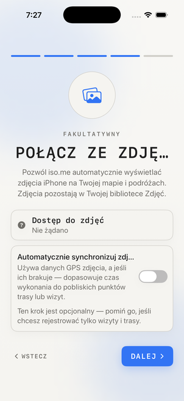
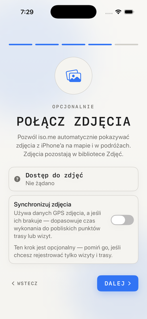

# Polish localization

Polish (`pl`, region `pl_PL`) is registered in Xcode and covers all nine string catalogs: iPhone, Apple Watch, both widget extensions, permission descriptions, and App Shortcuts. The catalog audit covers 1,326 active entries. This includes 179 recently added iPhone strings discovered in compiler extraction output, covering Country Days, saved locations, appearance, and myself.md access.

The first pass used the repository's machine translation helper. Contextual review corrected navigation actions, visits, journey terminology, GPS points, permissions, purchase plans, and Siri phrases. Long-form copy still needs native Polish editorial review before release. Screenshot marketing copy is included in `screenshots/localized-copy.json` and preserved by the generator's Polish overrides.

Polish count labels include `one`, `few`, `many`, and `other` forms. The export preview message no longer constructs an English plural by appending `s`; its replacement is translated in every existing language.

## Verification

```sh
python3 scripts/localization_catalog.py audit --locale pl \
  --extracted-from /tmp/isome-polish-build/Build/Intermediates.noindex
python3 scripts/test_localization_catalog.py
xcodebuild build -project IsoMe.xcodeproj -scheme IsoMe \
  -destination 'platform=iOS Simulator,id=<SIMULATOR_UDID>' \
  -derivedDataPath /tmp/isome-polish-build CODE_SIGNING_ALLOWED=NO
swift scripts/check_polish_localization.swift \
  /tmp/isome-polish-build/Build/Products/Debug-iphonesimulator/IsoMe.app
```

- Polish coverage and placeholder audit: passed, with no unexplained English copies.
- iOS simulator build, including Watch and widget catalog compilation: passed.
- Foundation runtime checks of compiled resources: 162 passed (144 Polish checks and 18 English plural regression checks), including counts 0, 1, 2, 4, 5, 12, 14, 21, 22, 25, 101, and 102.
- Compiler-extracted localization keys missing across all four app targets: zero (114 extraction files).
- Existing catalog entries in all other languages: preserved.
- Polish welcome and feature screens: visually checked through Argent. A truncated feature heading was shortened to `FUNKCJE` and rechecked. The recorded onboarding check replayed successfully. The temporary flow used an AX-derived coordinate for Next because the native flow tree did not expose its label; live AX text checks verified both destinations.

The visual check used a separate temporary simulator app identifier and a copy of the compiled bundle containing only Polish resources. It did not change the simulator's language or the existing app's data. This checks localized layout, not a full device-region or Watch UI walkthrough.

The second pass also added 20 catalog entries for strings that previously bypassed localization, including default outing names, minimum-point labels, webhook actions, photo-cluster descriptions, map summaries, and Watch sync errors. Localized values now reach their UI and VoiceOver callers. English plural handling is preserved when filling catalogs. Five audit-tool regression tests and 82 targeted app tests passed during implementation. After integrating with GitHub main, all 275 app tests passed with simulator signing enabled (`CODE_SIGNING_ALLOWED=YES CODE_SIGN_IDENTITY=-`). The initial unsigned full-suite run failed seven Keychain tests; signing resolved all seven.

The remaining onboarding pages, the localized permission explanation, and the map were checked in the simulator. The photo heading and sync toggle were shortened after visible truncation and then visually rechecked. The recorded path through permission denial, photo setup, completion, release notes, and the map replayed successfully. AX checks verified `0 wizyt. 0 punktów trasy` and `Śledzenie jest wyłączone.` The temporary replay uses AX-derived coordinates because the native flow tree omits several SwiftUI labels; it is a local verification aid, not a committed regression test.

Integration with current GitHub main added Polish translations for 25 newer photo-map and release-note strings while retaining its photo-area behavior. Unused manual Watch-sync strings from a separate local commit are excluded. The all-language audit still reports gaps because newly cataloged strings have English and Polish translations. App Store Connect metadata and screenshots have not been published.

## Review screenshots

| Before | After |
| --- | --- |
|  |  |

## Project environment

Environment inspection for future localization work:

```json
{
  "workspace_path": "/Users/codybontecou/dev/iso.me",
  "is_react_native": false,
  "is_native_ios": true,
  "is_native_android": false,
  "framework": "SwiftUI with SwiftData",
  "project": "IsoMe.xcodeproj",
  "scheme": "IsoMe",
  "bundle_id": "com.bontecou.isome",
  "platforms": ["iOS", "watchOS"],
  "metro_required": false,
  "argent_available": true,
  "qa": ["IsoMeTests", "scripts/localization_catalog.py", "scripts/check_polish_localization.swift"]
}
```
